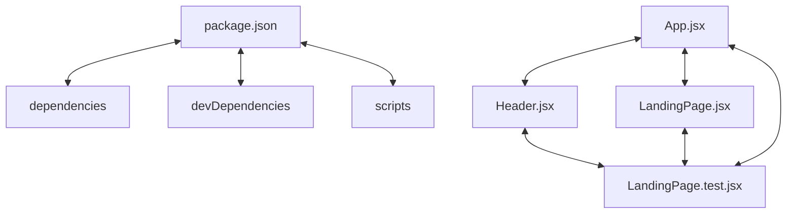

# Codebase Architectural Report

> **Auto-generated** by graphify knowledge graph analysis  
> **Purpose**: Dependency map, connection analysis, subsystem breakdown, and quality hotspots.

---

## 1. Executive Summary

- **Total Components**: `57`
- **Total Connections**: `56`
- **Subsystem Modules**: `1`
- **Dependency Types**: `4`

**Key Architectural Hubs:**

| # | Component | File | Type | Connections |
|---|-----------|------|------|-------------|
| 1 | `devDependencies` | `frontend/package.json` | function | 9 |
| 2 | `package.json` | `frontend/package.json` | function | 7 |
| 3 | `App.jsx` | `frontend/src/App.jsx` | class | 7 |
| 4 | `LandingPage.test.jsx` | `frontend/src/pages/LandingPage.test.jsx` | class | 7 |
| 5 | `dependencies` | `frontend/package.json` | function | 5 |
| 6 | `LandingPage.jsx` | `frontend/src/pages/LandingPage.jsx` | class | 5 |
| 7 | `scripts` | `frontend/package.json` | function | 4 |
| 8 | `Header.jsx` | `frontend/src/components/Header.jsx` | class | 4 |

---

## 2. Dependency & Connection Analysis

### Relationship Types

| Relationship | Count | Share |
|-------------|-------|-------|
| `contains` | 31 | 55% |
| `imports` | 18 | 32% |
| `imports_from` | 6 | 11% |
| `calls` | 1 | 2% |

### Hub Dependency Diagram

### Most Connected Pairs

| Component A | Component B | Shared Connections |
|-------------|-------------|-------------------|
| `captureBrowserErrors()` | `landing.spec.js` | 1 |
| `dependencies` | `package.json` | 1 |
| `devDependencies` | `package.json` | 1 |
| `name` | `package.json` | 1 |
| `package.json` | `private` | 1 |
| `package.json` | `scripts` | 1 |
| `package.json` | `type` | 1 |
| `package.json` | `version` | 1 |
| `build` | `scripts` | 1 |
| `dev` | `scripts` | 1 |

---

## 3. Subsystem & Module Breakdown

### 3.1 frontend/src
**Nodes**: `57`  
**Files**: `frontend/e2e/landing.spec.js`, `frontend/index.html`, `frontend/package.json`, `frontend/src/App.jsx`, `frontend/src/components/Header.jsx`, `frontend/src/main.jsx` +6 more

| Component | Type | File | Connections |
|-----------|------|------|-------------|
| `devDependencies` | function | `frontend/package.json` | 9 |
| `package.json` | function | `frontend/package.json` | 7 |
| `App.jsx` | class | `frontend/src/App.jsx` | 7 |
| `LandingPage.test.jsx` | class | `frontend/src/pages/LandingPage.test.jsx` | 7 |
| `dependencies` | function | `frontend/package.json` | 5 |
| `LandingPage.jsx` | class | `frontend/src/pages/LandingPage.jsx` | 5 |
| `scripts` | function | `frontend/package.json` | 4 |
| `Header.jsx` | class | `frontend/src/components/Header.jsx` | 4 |
| `Header()` | class | `frontend/src/components/Header.jsx` | 4 |
| `App()` | class | `frontend/src/App.jsx` | 3 |

---

## 4. API Reference

Public classes and functions by subsystem.

### frontend/src

| Name | Type | File | Connections |
|------|------|------|-------------|
| `devDependencies` | function | `frontend/package.json` | 9 |
| `package.json` | function | `frontend/package.json` | 7 |
| `App.jsx` | class | `frontend/src/App.jsx` | 7 |
| `LandingPage.test.jsx` | class | `frontend/src/pages/LandingPage.test.jsx` | 7 |
| `dependencies` | function | `frontend/package.json` | 5 |
| `LandingPage.jsx` | class | `frontend/src/pages/LandingPage.jsx` | 5 |
| `scripts` | function | `frontend/package.json` | 4 |
| `Header.jsx` | class | `frontend/src/components/Header.jsx` | 4 |

---

## 5. Code Quality & Architectural Risk Hotspots

### Component Type Distribution

| Type | Count | Share |
|------|-------|-------|
| function | 42 | 74% |
| class | 9 | 16% |
| file | 3 | 5% |
| method | 3 | 5% |

### Dependency Cycles

**9** circular dependency loop(s) detected:

| # | Cycle Path |
|---|-----------|
| 1 | `frontend_src_app → frontend_src_pages_landingpage_landingpage → frontend_src_pages_landingpage_test` |
| 2 | `frontend_src_pages_landingpage → frontend_src_pages_landingpage_landingpage → frontend_src_pages_landingpage_test` |
| 3 | `frontend_src_app → frontend_src_pages_landingpage → frontend_src_pages_landingpage_test` |
| 4 | `frontend_src_app → frontend_src_components_header_header → frontend_src_pages_landingpage_test` |
| 5 | `frontend_src_components_header → frontend_src_components_header_header → frontend_src_pages_landingpage_test` |
| 6 | `frontend_src_components_header → frontend_src_components_header_getadminauthentication → frontend_src_components_header_header` |
| 7 | `frontend_src_app → frontend_src_components_header → frontend_src_pages_landingpage_test` |
| 8 | `frontend_src_app → frontend_src_app_app → frontend_src_pages_landingpage_test` |
| 9 | `frontend_src_app → frontend_src_main → frontend_src_app_app` |

### Orphaned Components

**6** isolated node(s) with no connections:

| Component | File |
|-----------|------|
| `setup.js` | `frontend/src/test/setup.js` |
| `vite.config.js` | `frontend/vite.config.js` |
| `public-discovery` | `todos.yaml` |
| `candidate-submission` | `todos.yaml` |
| `admin-management` | `todos.yaml` |
| `HireHub Build Your Future` | `frontend/index.html` |

---

## 6. How to Navigate

1. **Interactive D3 Map** — open `graph.html` to explore node connections visually.
2. **Knowledge Graph Queries** — use MCP tools (`graph_query`, `graph_explain_node`, `graph_impact_radius`).
